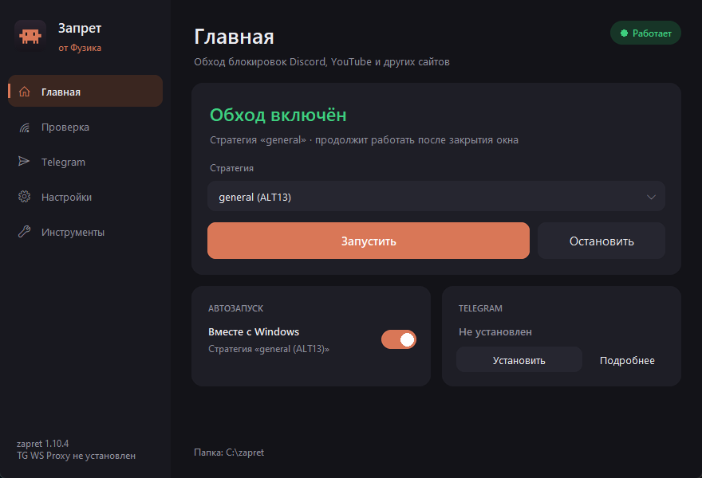
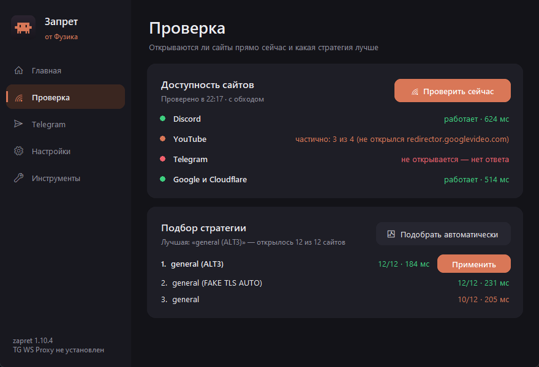
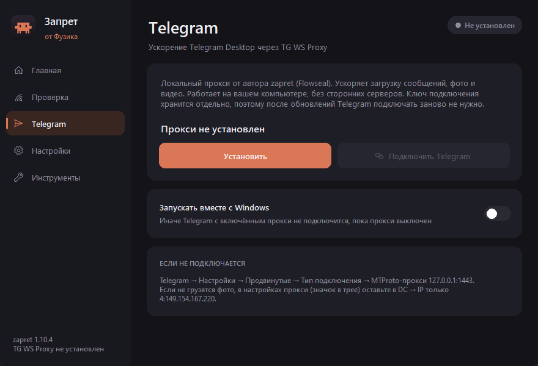
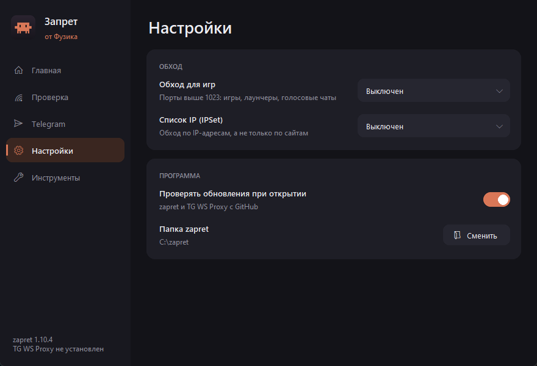
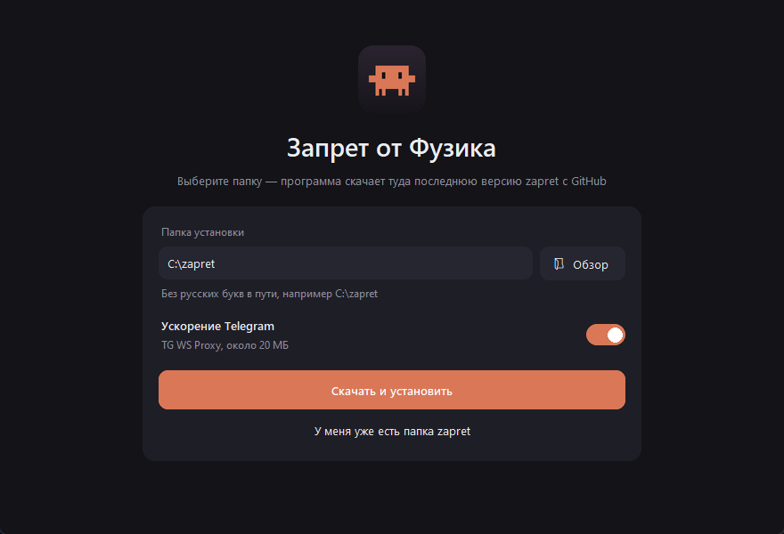

<div align="center">

# Запрет от Фузика

**Удобная программа для обхода блокировок Discord, YouTube и ускорения Telegram на Windows**

Всё в одном окне: без батников и командной строки

[**⬇ Скачать последнюю версию**](https://github.com/Fuzedev-design/zapret-fuzik/releases/latest) · [📄 Инструкция (PDF)](docs/Инструкция%20—%20Запрет%20от%20Фузика.pdf)



</div>

## Что умеет

- **Сама скачивает и обновляет** [zapret-discord-youtube](https://github.com/Flowseal/zapret-discord-youtube) с GitHub в выбранную вами папку
- **Запускает и останавливает обход** одной кнопкой, без чёрных окон консоли
- **Подбирает лучшую стратегию автоматически**: перебирает все варианты и проверяет, открываются ли Discord, YouTube и Google
- **Проверяет подключение**: показывает, какие сервисы доступны прямо сейчас
- **Автозапуск вместе с Windows**: включается одним переключателем
- **Ускоряет Telegram** через [TG WS Proxy](https://github.com/Flowseal/tg-ws-proxy) и подключает его в Telegram в один клик
- **Обход для игр**, режимы списка IP, ваши списки сайтов и исключений
- **Обновляет и саму себя**: когда здесь выходит новая версия, программа предложит обновиться, сверит контрольную сумму и перезапустится
- **Переносится на другой компьютер одним файлом**: на новом ПК программа сама предложит папку и скачает свежие версии

## Как начать

1. Скачайте `Zapret-ot-Fuzika.exe` со [страницы релизов](https://github.com/Fuzedev-design/zapret-fuzik/releases/latest)
2. Запустите его и нажмите «Да» на вопрос о правах администратора
3. Выберите папку без русских букв (например `C:\zapret`) и нажмите **«Скачать и установить»**
4. Откройте **«Проверка»** → **«Подобрать автоматически»** → **«Применить»**

Подробно, со скриншотами: [инструкция в PDF](docs/Инструкция%20—%20Запрет%20от%20Фузика.pdf).

> [!IMPORTANT]
> Не удаляйте `Запрет от Фузика.exe` после установки: через него обход включается и выключается, подбирается стратегия и проверяются обновления.

## Скриншоты

| Проверка и подбор стратегии | Telegram |
|---|---|
|  |  |
| **Настройки** | **Первый запуск** |
|  |  |

## Требования

- Windows 10 или 11, 64-бит
- Права администратора (без них zapret не может работать с сетью)
- Интернет с доступом к GitHub для скачивания zapret

## Антивирус и SmartScreen

У программы нет цифровой подписи, поэтому Windows может показать окно «Windows защитила ваш компьютер». Нажмите «Подробнее» → «Выполнить в любом случае».

Антивирусы иногда ошибочно реагируют на программы, собранные PyInstaller, и на драйвер WinDivert, который нужен zapret. Это ложная тревога: исходный код целиком открыт в этом репозитории, а сам zapret скачивается с [официальной страницы Flowseal](https://github.com/Flowseal/zapret-discord-youtube/releases). При проблемах добавьте программу и папку с zapret в исключения антивируса.

## Сборка из исходников

Нужен Python 3.12+ с tkinter.

```bash
pip install pillow truststore pyinstaller
build.bat
```

Готовый файл появится в папке `dist`.

| Файл | Что внутри |
|---|---|
| `zapret_fuzik.py` | Логика: установка и обновление zapret, стратегии, служба, настройки, TG WS Proxy, проверка подключения |
| `app_ui.py` | Окно программы: меню и страницы |
| `ui_kit.py` | Закруглённые элементы интерфейса и иконка |

## Благодарности

- [Flowseal/zapret-discord-youtube](https://github.com/Flowseal/zapret-discord-youtube) — стратегии и сборка zapret для Windows
- [bol-van/zapret](https://github.com/bol-van/zapret) — сам zapret
- [Flowseal/tg-ws-proxy](https://github.com/Flowseal/tg-ws-proxy) — прокси для ускорения Telegram

Эта программа — только удобная оболочка: она не содержит файлов zapret и TG WS Proxy, а скачивает их с официальных страниц авторов.

## Лицензия

[MIT](LICENSE)
